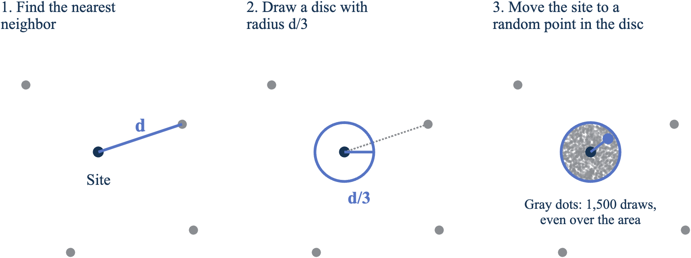
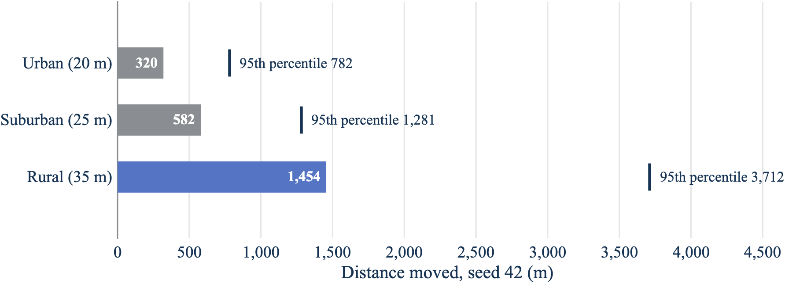
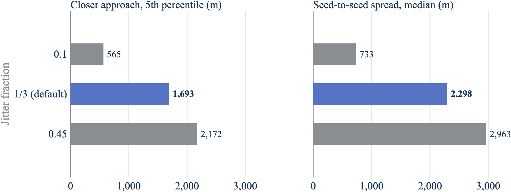

# Seeded jitter of approximate base station locations

DRAFT//PRE-DECISIONAL

**Working paper, rev1.** November 7, 2026. Code baseline: `base_station_jitter` commit `0cd551ffb88ecde868a5927a47eb7a316ab3e54f`.

## Overview

Interference and coordination studies need a base station deployment. The deployment tables used in the FSS Neighborhood analysis, such as `Rand_Table_RSU_HIAK.xlsx`, give approximate base station locations rather than surveyed ones. A study that treats an approximate location as exact can report a separation distance, and so an interference level, with more confidence than the input supports.

This paper describes a method that turns one approximate deployment table into many plausible deployments. The model moves each base station to a random point inside a disc centered on its listed location. The disc radius is a fixed fraction, one third by default, of the distance to the nearest other base station, so sites in dense areas move a little and isolated sites move more. An optional cap limits the radius for isolated sites. A seed controls the random draws, so each realization is exactly repeatable.

The paper covers the method, how the code verifies it, the results of one identified run on the 62,113-site HIAK table, and a red-team review of what the method does and doesn't support. It doesn't evaluate interference: the method changes only the latitude and longitude that a downstream study reads.

## Problem the method addresses

A deployment table built by approximation, for example by placing sites on a grid or at area centroids, can be close to the real network on average and still be wrong for any single site. Federal protection analyses are often sensitive to exactly that: the distance from the nearest few base stations to a protected receiver.

Jitter turns location uncertainty into an explicit input. Instead of one deployment, the analysis runs on a set of seeded realizations and reports the spread of outcomes. The method makes three design commitments:

- **Local scale.** The size of each move tracks local site spacing, so a move never exceeds a fixed share of the gap to the nearest neighbor.
- **No new artifacts.** Two sites can't meet or swap places, and every column other than latitude and longitude passes through unchanged.
- **Repeatability.** The same table, seed, and settings always give the same deployment.

## Jitter method

The method has three steps for each site, shown in Figure 1: find the nearest neighbor, draw a disc whose radius is a fraction of that distance, and move the site to a random point inside the disc.

**Figure 1. Each site moves to a random point within one third of the distance to its nearest neighbor.**



The points are illustrative. Panel 3 uses the same draw as the model, a distance of the radius times the square root of a uniform random number, so the 1,500 draws spread evenly over the disc's area. Source: base_station_jitter repository.

### Nearest-neighbor distance

For each base station, the model finds the nearest other base station at a distinct location and measures the geodesic distance between them on the World Geodetic System 1984 (WGS 84) ellipsoid. To keep the search fast for tens of thousands of sites, the model converts each location to Earth-centered, Earth-fixed (ECEF) coordinates, uses a k-d tree to find the three nearest candidates by straight-line chord distance, and then ranks those three by exact geodesic distance.[^nn]

Chord distance and geodesic distance rank neighbors almost identically, but not exactly, on an ellipsoid. On the HIAK table, ranking the closest 3 candidates gave the same nearest-neighbor distance for every site as ranking the closest 15. In one site, the geodesic winner wasn't the chord-nearest candidate, which is why the geodesic re-ranking step exists. This comparison is a check performed for this paper, not part of the repository's tests.

### Jitter radius

The jitter radius for site *i* is

| Equation | |
| --- | --- |
| *R*<sub>*i*</sub> = min(*f* · *d*<sub>*i*</sub>, *R*<sub>max</sub>) | (1) |

Where:

- *R*<sub>*i*</sub> is the jitter radius, in meters.
- *f* is the jitter fraction. It defaults to 1/3 and must be greater than zero and less than one half.[^frac]
- *d*<sub>*i*</sub> is the geodesic distance to the nearest distinct neighbor, in meters.
- *R*<sub>max</sub> is the optional radius cap, in meters. It defaults to no cap.[^cap]

### Random position inside the disc

The model draws two independent uniform random numbers, *U*<sub>1</sub> and *U*<sub>2</sub>, on the interval from 0 to 1 for each site, and sets the move distance and direction as

| Equation | |
| --- | --- |
| *r*<sub>*i*</sub> = *R*<sub>*i*</sub> · √*U*<sub>1</sub> | (2) |
| *θ*<sub>*i*</sub> = 360° · *U*<sub>2</sub> | (3) |

Where *r*<sub>*i*</sub> is the move distance in meters and *θ*<sub>*i*</sub> is the azimuth in degrees, clockwise from north.[^draw]

The square root in Equation 2 makes the new location uniform over the area of the disc. A uniform point in a disc of radius *R* falls within distance *ρ* of the center with probability (*ρ*/*R*)², so the distance is *R*√*U*. Without the square root, points would cluster near the center.

The model then moves each site the distance *r*<sub>*i*</sub> along the geodesic at azimuth *θ*<sub>*i*</sub> on the same reference ellipsoid.[^move] Using the same ellipsoid for the radius and the move keeps the two consistent.

### Duplicate locations

Two or more rows can share one location. The model collapses duplicates before the neighbor search, so each duplicate takes the nearest *distinct* location as its neighbor and gets a nonzero radius.[^dup] Duplicates then receive separate random draws and separate. The HIAK table has one duplicate pair.

### Separation guarantee

For any two sites a geodesic distance *D* apart, each site's nearest-neighbor distance is at most *D*, so each moves at most *f* · *D*. By the triangle inequality, their separation after jitter is at least

| Equation | |
| --- | --- |
| *D*′ ≥ (1 − 2*f*) · *D* | (4) |

With *f* less than one half, *D*′ stays positive, so jittered sites never meet. At the default *f* of 1/3, every pair keeps at least one third of its original separation (derived). The cap only shrinks radii, so it preserves the guarantee.

## Reproducibility

The model draws all random numbers from its own random number stream, using the combined multiple recursive generator `mrg32k3a`, seeded by the caller.[^seed] The global MATLAB random state isn't touched, so calling the jitter inside a larger simulation doesn't change that simulation's other random draws. A seed is required; the model stops with an error rather than fall back to a default.

The model takes two consecutive draws per site, the distance draw and then the azimuth draw, in row order.[^draw] A site's draws therefore depend only on the seed and its row position. Adding rows to the end of a table doesn't change the jitter of the rows before them, and a capped site keeps the same draws as an uncapped one, scaled to the cap.

## Spreadsheet interface and data handling

The spreadsheet function takes the input file and the seed, plus optional settings for the jitter fraction, the radius cap, an output file, and the names of the latitude and longitude columns.[^tableargs] It reads the table, jitters the coordinates, and returns the table with every other column unchanged and in the same order, so the result can replace the input in downstream code.

The function stops with an error, rather than continue, in four cases:

- A named coordinate column is missing.[^missingcol]
- A coordinate is not numeric, blank, or not a number.[^badcoord]
- Any column has a blank, not-a-number, or unreadable value. The table reader converts unreadable text to not-a-number without warning, and a silent gap in a column such as antenna height would corrupt the downstream run.[^missingval]
- The output file is the input file.[^overwrite]

When an output file is requested, the function writes it to a uniquely named temporary file in the same folder and then renames it into place in one atomic step.[^atomic] Several servers can then write the same seed's output at the same time without a reader ever seeing a partial file. The repository's test for this case runs two parallel workers against one output file.

## Verification

The repository has 24 unit tests in two test files. All 24 passed in MATLAB R2025b during this review. The tests check these behaviors:

| Behavior | Test |
| --- | --- |
| The same seed gives the same output, and a different seed gives a different output. | Core and table tests[^t_seed] |
| The global random state is unchanged. | Core test[^t_rng] |
| Every site stays inside its radius, and the reported move distance matches the measured one. | Core test[^t_inside] |
| The nearest-neighbor distance matches an exhaustive all-pairs geodesic search. | Core test[^t_brute] |
| No two sites meet. | Core test[^t_meet] |
| New positions are uniform over the disc area, by a Kolmogorov-Smirnov test on the squared normalized distance. | Core test[^t_ks] |
| Duplicate locations get a nonzero radius and separate. | Core test[^t_dup] |
| A site's draws don't depend on later rows. | Core test[^t_prefix] |
| The cap affects only radii above it, and capped sites keep their draws. | Core tests[^t_cap] |
| Other columns pass through unchanged, and the output file reads back identical. | Table tests[^t_cols] |
| Bad inputs raise the expected errors. | Core and table tests[^t_err] |
| Two parallel writers never expose a partial output file. | Table test[^t_race] |
| The full HIAK table jitters cleanly. | Table test[^t_hiak] |

These tests establish the behaviors they check. They don't establish that one third is the right fraction or that jittered deployments match real networks.

## Results on the HIAK table

The results in this section come from one identified run: `red_team_experiments_rev1.m` at the code baseline, run in MATLAB R2025b (25.2) Update 4 on November 7, 2026, against `Rand_Table_RSU_HIAK.xlsx`. The raw output is in `red_team_log_rev1.txt`.[^log] The receivers in this section are synthetic points, not federal sites.

### Size of the moves

Figure 2 shows the method on the 152 Oahu sites in the table. Dense urban sites near Honolulu move a few hundred meters; isolated sites away from the city move up to a few kilometers.

**Figure 2. On Oahu, dense sites move a few hundred meters and isolated sites move up to a few kilometers.**


Seed 42, default fraction of 1/3, no cap. Positions are plotted in local east and north kilometers for display; the model computes every distance on the WGS 84 ellipsoid. Source: NTIA analysis of `Rand_Table_RSU_HIAK.xlsx` with `base_station_jitter` (2026).

With seed 42 and the default settings, the median site moves 677.4 m.[^log] Move size tracks clutter class, which the table encodes in antenna height, as Figure 3 and the following table show:[^log]

**Figure 3. Rural sites move more than four times as far as urban sites.**



Seed 42, all 62,113 sites, default fraction, no cap. Source: `red_team_log_rev1.txt`.

| Height (clutter class) | Sites | Median nearest neighbor | Median move | 95th percentile move | Largest move |
| --- | --- | --- | --- | --- | --- |
| 20 m (urban) | 16,212 | 1,629 m | 320 m | 782 m | 3,058 m |
| 25 m (suburban) | 20,994 | 2,777 m | 582 m | 1,281 m | 8,932 m |
| 35 m (rural) | 24,907 | 7,067 m | 1,454 m | 3,712 m | 103,555 m |

The largest uncapped move, about 104 km, belongs to an isolated rural site. A 5 km cap changes the radius of 1,076 sites, 1.7% of the table (derived); a 2 km cap changes 14,823 sites, 23.9% (derived).[^log]

### Bias

Across all sites with seed 42, the mean displacement is 3.2 m north, with a standard error of 4.0 m, and 0.5 m east, with a standard error of 4.1 m.[^log] Both are consistent with zero: the method doesn't shift the deployment in any direction.

### Separation from receivers

To measure what jitter does to the distance that drives most protection analyses, the experiment placed 500 synthetic receivers 5 km to 30 km from randomly chosen on-land base stations and ran 20 seeds at each of three fractions, summarized in the following table and in Figure 4.[^log]

| Fraction | Nearest station closer | Median change | 5th percentile change | Worst case | Seed-to-seed spread (median / 95th percentile) |
| --- | --- | --- | --- | --- | --- |
| 0.1 | 50.9% | -5 m | -565 m | -3,227 m | 733 m / 2,090 m |
| 1/3 | 49.4% | +11 m | -1,693 m | -10,824 m | 2,298 m / 6,477 m |
| 0.45 | 48.6% | +29 m | -2,172 m | -13,943 m | 2,963 m / 8,333 m |

**Figure 4. Larger jitter widens how much closer a station can get to a receiver.**



Five hundred synthetic receivers, 20 seeds per fraction. Left: how much closer the nearest base station gets in the worst 5% of receiver-seed cases. Right: how much the nearest distance varies across seeds for a typical receiver. Source: `red_team_log_rev1.txt`.

The nearest base station moves closer about as often as it moves away, and the median change is small. The tails are not small, and Figure 4 shows they grow with the jitter fraction. At the default fraction, the nearest station ends up at least 1,693 m closer in 5% of receiver-seed cases, and the spread across seeds has a median of 2,298 m. The mean number of base stations within 10 km of a receiver barely changes, 20.37 after jitter against 20.34 before, so aggregate density is preserved even when individual neighbors move.[^log]

### Placement in water

Using the public Census 1:500,000 state boundaries as the land mask, 0.55% of on-land sites end up off land in each realization, averaged over 5 seeds.[^log] The cap barely changes this (0.52% at 2 km), so the cause is coastal sites moving a short distance offshore rather than long moves. The source table already has 83 sites, 0.13%, off land in the same mask. The repository doesn't include a land check; this is a known limitation.

## Red-team summary

`RED_TEAM_rev1.md` attacks the method from the view of a skeptical federal spectrum office. Its two strongest objections are about use, not code:

1. **A single seed can change a coordination answer.** The seed-to-seed spread above means one realization isn't a result. The analysis should run a fixed, published list of seeds and report the distribution across them.
1. **The jitter fraction has no empirical basis.** One third is a modeling choice. The closer-approach tail grows with the fraction, so the choice matters, and it should be tied to the measured error of the approximation against known locations.

The review also notes that a moved site keeps its original clutter class. That's correct for small moves but can be wrong for a rural site that moves 1.5 km toward a suburb.

## Input parameters

| Parameter | Value | Units | Provenance | Source |
| --- | --- | --- | --- | --- |
| Jitter fraction *f* | 1/3 | none | Driver setting, equal to the function default | `run_jitter_rsu_hiak_rev1.m:11` and `jitter_base_stations_rev1.m:48` |
| Allowed range of *f* | positive and less than 0.5 | none | Input validation | `jitter_base_stations_rev1.m:48` |
| Radius cap *R*<sub>max</sub> | Inf (no cap) | m | Driver setting, equal to the function default | `run_jitter_rsu_hiak_rev1.m:12` and `jitter_base_stations_rev1.m:49` |
| Seed | 42 | none | Driver setting; required by the function | `run_jitter_rsu_hiak_rev1.m:10` |
| Reference ellipsoid | `wgs84Ellipsoid("m")` | m | Function default | `jitter_base_stations_rev1.m:50` |
| Neighbor candidates | 3 nearest by chord distance | sites | Hardcoded | `jitter_base_stations_rev1.m:77` |
| Random generator | `mrg32k3a` | none | Hardcoded | `jitter_base_stations_rev1.m:98` |
| Input table | `Rand_Table_RSU_HIAK.xlsx` | file | Driver setting; file in the repository | `run_jitter_rsu_hiak_rev1.m:13` |
| Coordinate columns | `Latitude`, `Longitude` | degrees | Function default | `jitter_base_station_table_rev1.m:45-46` |

## Open items

1. **Calibrate the fraction and cap.** No comparison to known base station locations exists, so the right fraction and cap are unknown. Public site data, such as FCC antenna structure registrations, could provide one.
1. **Use real receivers.** The separation results use synthetic receivers. Rerunning them against public FCC earth station locations would show the effect where it matters.
1. **Set a seed policy.** Decide how many seeds a study runs and publish the list.
1. **Decide on clutter class.** Height and clutter class carry over unchanged after a move. Reassigning them needs a land-cover dataset.
1. **Measure interference, not geometry.** This paper reports distances and counts. The effect on I/N or aggregate interference depends on propagation and antenna patterns and hasn't been run.
1. **Confirm markings.** This draft carries DRAFT//PRE-DECISIONAL in every header and footer. Confirm that no other markings apply before it leaves the team.
1. **Get an independent review.** The author of the code wrote this paper and the red-team review. A separate reviewer should repeat both before they support a briefing or filing.

## Appendix A: code traceability

### Baseline

| Item | Value |
| --- | --- |
| Repository | `nicklasorte/base_station_jitter` |
| Commit | `0cd551ffb88ecde868a5927a47eb7a316ab3e54f` |
| Entry point | `run_jitter_rsu_hiak_rev1.m` |
| MATLAB | R2025b (25.2) Update 4 |
| Products required | MATLAB, Mapping Toolbox, Statistics and Machine Learning Toolbox |

The red-team experiments also need the public Census file `cb_2023_us_state_500k`, which isn't in the repository.

### Evidence map

| Claim | Implementation or source | Configuration | Evidence level |
| --- | --- | --- | --- |
| Radius is min(*f* · *d*, *R*<sub>max</sub>) | `jitter_base_stations_rev1.m:48-49, 93` | Defaults *f* = 1/3, no cap | Static inspection; unit tests |
| Nearest neighbor is exact geodesic | `jitter_base_stations_rev1.m:75-88` | 3 candidates | Unit test against all-pairs search; HIAK check against 15 candidates (derived) |
| Positions are uniform over the disc | `jitter_base_stations_rev1.m:98-101` | None | Kolmogorov-Smirnov unit test |
| Sites can't meet | Equation 4; `jitter_base_stations_rev1.m:48` | *f* < 0.5 | Derivation; unit test |
| Results are repeatable | `jitter_base_stations_rev1.m:98-99` | Seed required | Unit tests |
| Output writes are atomic | `jitter_base_station_table_rev1.m:100-120` | Output file set | Two-worker unit test |
| HIAK results | `red_team_log_rev1.txt` | Run identified in "Results on the HIAK table" | Successful execution; synthetic receivers |

### Functions in scope

| Function | Role |
| --- | --- |
| `run_jitter_rsu_hiak_rev1` | Driver: sets the seed, fraction, cap, and file names for the HIAK table and prints summary statistics. |
| `jitter_base_station_table_rev1` | Reads and checks the spreadsheet, calls the core function, and writes the output. |
| `jitter_base_stations_rev1` | Core method: nearest-neighbor distance, radius, random draw, and geodesic move. |
| `make_figures_rev1` | Draws Figures 1 through 4. Figures 2 and 3 are recomputed from the HIAK table; Figure 3 is checked against the run log, and Figure 4 is read from it. |
| `briefing_style` | Applies the NTIA figure style (palette, Times New Roman). |
| `write_table_atomic`, `delete_if_exists` | File helpers for the atomic write. |

### Call graph

```
run_jitter_rsu_hiak_rev1
  jitter_base_station_table_rev1
    jitter_base_stations_rev1
    write_table_atomic
      delete_if_exists
```

[^nn]: [jitter_base_stations_rev1.m lines 75-88](https://github.com/nicklasorte/base_station_jitter/blob/0cd551ffb88ecde868a5927a47eb7a316ab3e54f/jitter_base_stations_rev1.m#L75-L88)
[^frac]: [jitter_base_stations_rev1.m line 48](https://github.com/nicklasorte/base_station_jitter/blob/0cd551ffb88ecde868a5927a47eb7a316ab3e54f/jitter_base_stations_rev1.m#L48)
[^cap]: [jitter_base_stations_rev1.m line 49](https://github.com/nicklasorte/base_station_jitter/blob/0cd551ffb88ecde868a5927a47eb7a316ab3e54f/jitter_base_stations_rev1.m#L49) and [line 93](https://github.com/nicklasorte/base_station_jitter/blob/0cd551ffb88ecde868a5927a47eb7a316ab3e54f/jitter_base_stations_rev1.m#L93)
[^draw]: [jitter_base_stations_rev1.m lines 98-101](https://github.com/nicklasorte/base_station_jitter/blob/0cd551ffb88ecde868a5927a47eb7a316ab3e54f/jitter_base_stations_rev1.m#L98-L101)
[^move]: [jitter_base_stations_rev1.m line 104](https://github.com/nicklasorte/base_station_jitter/blob/0cd551ffb88ecde868a5927a47eb7a316ab3e54f/jitter_base_stations_rev1.m#L104)
[^dup]: [jitter_base_stations_rev1.m lines 64-69](https://github.com/nicklasorte/base_station_jitter/blob/0cd551ffb88ecde868a5927a47eb7a316ab3e54f/jitter_base_stations_rev1.m#L64-L69) and [lines 91-92](https://github.com/nicklasorte/base_station_jitter/blob/0cd551ffb88ecde868a5927a47eb7a316ab3e54f/jitter_base_stations_rev1.m#L91-L92)
[^seed]: [jitter_base_stations_rev1.m lines 53-56](https://github.com/nicklasorte/base_station_jitter/blob/0cd551ffb88ecde868a5927a47eb7a316ab3e54f/jitter_base_stations_rev1.m#L53-L56) and [line 98](https://github.com/nicklasorte/base_station_jitter/blob/0cd551ffb88ecde868a5927a47eb7a316ab3e54f/jitter_base_stations_rev1.m#L98)
[^tableargs]: [jitter_base_station_table_rev1.m lines 39-47](https://github.com/nicklasorte/base_station_jitter/blob/0cd551ffb88ecde868a5927a47eb7a316ab3e54f/jitter_base_station_table_rev1.m#L39-L47)
[^missingcol]: [jitter_base_station_table_rev1.m lines 54-59](https://github.com/nicklasorte/base_station_jitter/blob/0cd551ffb88ecde868a5927a47eb7a316ab3e54f/jitter_base_station_table_rev1.m#L54-L59)
[^badcoord]: [jitter_base_station_table_rev1.m lines 62-65](https://github.com/nicklasorte/base_station_jitter/blob/0cd551ffb88ecde868a5927a47eb7a316ab3e54f/jitter_base_station_table_rev1.m#L62-L65)
[^missingval]: [jitter_base_station_table_rev1.m lines 66-74](https://github.com/nicklasorte/base_station_jitter/blob/0cd551ffb88ecde868a5927a47eb7a316ab3e54f/jitter_base_station_table_rev1.m#L66-L74)
[^overwrite]: [jitter_base_station_table_rev1.m lines 85-95](https://github.com/nicklasorte/base_station_jitter/blob/0cd551ffb88ecde868a5927a47eb7a316ab3e54f/jitter_base_station_table_rev1.m#L85-L95)
[^atomic]: [jitter_base_station_table_rev1.m lines 100-120](https://github.com/nicklasorte/base_station_jitter/blob/0cd551ffb88ecde868a5927a47eb7a316ab3e54f/jitter_base_station_table_rev1.m#L100-L120)
[^t_seed]: [test_jitter_base_stations_rev1.m lines 20-30](https://github.com/nicklasorte/base_station_jitter/blob/0cd551ffb88ecde868a5927a47eb7a316ab3e54f/test_jitter_base_stations_rev1.m#L20-L30) and [test_jitter_base_station_table_rev1.m lines 30-40](https://github.com/nicklasorte/base_station_jitter/blob/0cd551ffb88ecde868a5927a47eb7a316ab3e54f/test_jitter_base_station_table_rev1.m#L30-L40)
[^t_rng]: [test_jitter_base_stations_rev1.m lines 32-36](https://github.com/nicklasorte/base_station_jitter/blob/0cd551ffb88ecde868a5927a47eb7a316ab3e54f/test_jitter_base_stations_rev1.m#L32-L36)
[^t_inside]: [test_jitter_base_stations_rev1.m lines 38-43](https://github.com/nicklasorte/base_station_jitter/blob/0cd551ffb88ecde868a5927a47eb7a316ab3e54f/test_jitter_base_stations_rev1.m#L38-L43)
[^t_brute]: [test_jitter_base_stations_rev1.m lines 45-55](https://github.com/nicklasorte/base_station_jitter/blob/0cd551ffb88ecde868a5927a47eb7a316ab3e54f/test_jitter_base_stations_rev1.m#L45-L55)
[^t_meet]: [test_jitter_base_stations_rev1.m lines 57-61](https://github.com/nicklasorte/base_station_jitter/blob/0cd551ffb88ecde868a5927a47eb7a316ab3e54f/test_jitter_base_stations_rev1.m#L57-L61)
[^t_ks]: [test_jitter_base_stations_rev1.m lines 63-72](https://github.com/nicklasorte/base_station_jitter/blob/0cd551ffb88ecde868a5927a47eb7a316ab3e54f/test_jitter_base_stations_rev1.m#L63-L72)
[^t_dup]: [test_jitter_base_stations_rev1.m lines 74-81](https://github.com/nicklasorte/base_station_jitter/blob/0cd551ffb88ecde868a5927a47eb7a316ab3e54f/test_jitter_base_stations_rev1.m#L74-L81)
[^t_prefix]: [test_jitter_base_stations_rev1.m lines 83-88](https://github.com/nicklasorte/base_station_jitter/blob/0cd551ffb88ecde868a5927a47eb7a316ab3e54f/test_jitter_base_stations_rev1.m#L83-L88)
[^t_cap]: [test_jitter_base_stations_rev1.m lines 90-113](https://github.com/nicklasorte/base_station_jitter/blob/0cd551ffb88ecde868a5927a47eb7a316ab3e54f/test_jitter_base_stations_rev1.m#L90-L113)
[^t_cols]: [test_jitter_base_station_table_rev1.m lines 58-71](https://github.com/nicklasorte/base_station_jitter/blob/0cd551ffb88ecde868a5927a47eb7a316ab3e54f/test_jitter_base_station_table_rev1.m#L58-L71)
[^t_err]: [test_jitter_base_stations_rev1.m lines 115-121](https://github.com/nicklasorte/base_station_jitter/blob/0cd551ffb88ecde868a5927a47eb7a316ab3e54f/test_jitter_base_stations_rev1.m#L115-L121) and [test_jitter_base_station_table_rev1.m lines 89-110](https://github.com/nicklasorte/base_station_jitter/blob/0cd551ffb88ecde868a5927a47eb7a316ab3e54f/test_jitter_base_station_table_rev1.m#L89-L110)
[^t_race]: [test_jitter_base_station_table_rev1.m lines 120-153](https://github.com/nicklasorte/base_station_jitter/blob/0cd551ffb88ecde868a5927a47eb7a316ab3e54f/test_jitter_base_station_table_rev1.m#L120-L153)
[^t_hiak]: [test_jitter_base_station_table_rev1.m lines 155-163](https://github.com/nicklasorte/base_station_jitter/blob/0cd551ffb88ecde868a5927a47eb7a316ab3e54f/test_jitter_base_station_table_rev1.m#L155-L163)
[^log]: [red_team_log_rev1.txt](https://github.com/nicklasorte/base_station_jitter/blob/0cd551ffb88ecde868a5927a47eb7a316ab3e54f/red_team_log_rev1.txt), produced by [red_team_experiments_rev1.m](https://github.com/nicklasorte/base_station_jitter/blob/0cd551ffb88ecde868a5927a47eb7a316ab3e54f/red_team_experiments_rev1.m)
